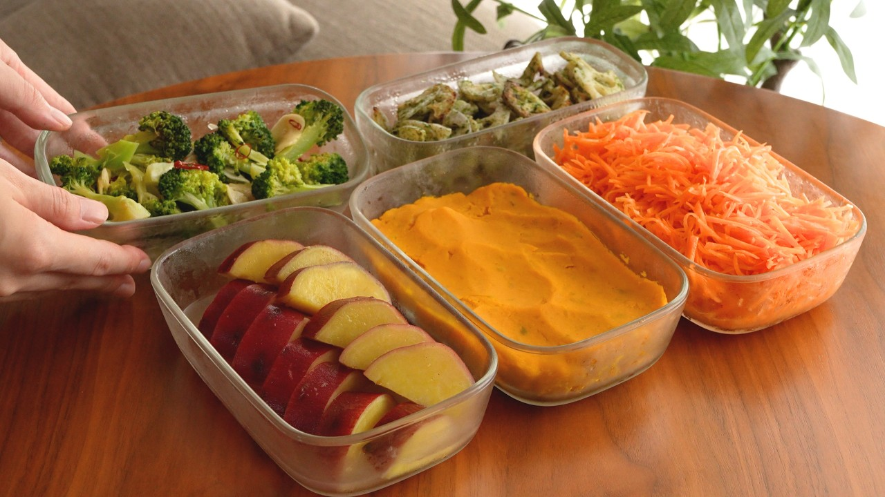

# 【秋の常備菜5選】一度覚えたら一生使える基本の副菜｜管理栄養士の作り置き

- 調べた日：2026-10-12（数字はいちばん新しい日の時点）
- チャンネル：おすぎ(管理栄養士)（@sugimeal、登録者 663,000人）
- 公開日：2026-09-19　長さ：23分22秒　形：横長
- 再生：1,172,263回（登録者の 1.8倍）　高評価：8,426　コメント：60
- URL：https://www.youtube.com/watch?v=0FJ-cwK8Sns

## サムネ

## 人気のコメント（いいねの多い順・上から10個）

1. （いいね 29）初コメです！ 社会に出て約15年間ほぼ外食だったんだけど、去年病気になったのをきっかけに健康＆節約のために自炊を開始。
 たまたまおすぎさんの動画にたどり着いて冷凍術や作り置きレシピを取得してからは食材を無駄にすることがなくなったし、下準備が出来ていることで自炊が苦じゃなくなった！ （今までは自炊のインターバルが１～２週間空いて野菜から根っこが生えてしまったり、食材を使い切らなきゃという気持ちで大量に作った結果飽きてしまい半分は食べずに腐るって感じでした） 食費も月10万～15万くらいだったのが、今では3万～4万円になりました。 本当にありがとう！（なおめっちゃ食うので体重に変化はない）
2. （いいね 23）温め直してお弁当に入れられますか？
3. （いいね 19）来週の冷凍弁当を作ろうとYouTubeを開いたらおすぎさんの新作✨ 秋ですね🍂 つい手を留めてしまいました😂 れんこん買っておけばよかった。 どれもアレンジしながら楽しめそう！ 本当にいつもありがとうございます🙇
4. （いいね 18）おすぎ新着動画きたああああああああ！！！！！！ 最近おすぎさんの冷凍弁当に慣れすぎて超スピーディーに料理ができるようになったんですよね！！ 余裕も出てきたのでバッコリ作ってみようと思います。 特に人参やさつまいもは一人暮らしだとあまりがちなのでレシピ紹介助かる……
5. （いいね 17）かぼちゃのやつ味薄めにしたら離乳食の子にあげられる。ありがたい
6. （いいね 12）のり塩レンコン作りました～ 美味しくて子供が大喜びだしポテチより罪悪感も無いのでまた作ります
7. （いいね 9）動画投稿待ってました！  どれも美味しそうですが、のり塩れんこん気になりすぎて早速作ってみます〜
8. （いいね 7）レンコンとにんじんも中途半端に余ってて、さつまいもちょうど買ってました！どうしようかと思ってたので助かります😭  にんじんの千切りが苦手なのですが、こういうやり方があるのか…！と感動しました😭
9. （いいね 7）ブロッコリーと人参はあるので明日れんこん、カボチャ、さつまいもを買ってこよう。どれも美味しそうなのに難しくないので作り置きします。 私は訓練してないので水気はよく切ってはねないようガードします😂
10. （いいね 6）指定野菜という基準？初めて知りました。 いつも勉強になります、感謝です。

## メモ（なぜ伸びた？ 視聴者は何を求めている？）

- 
