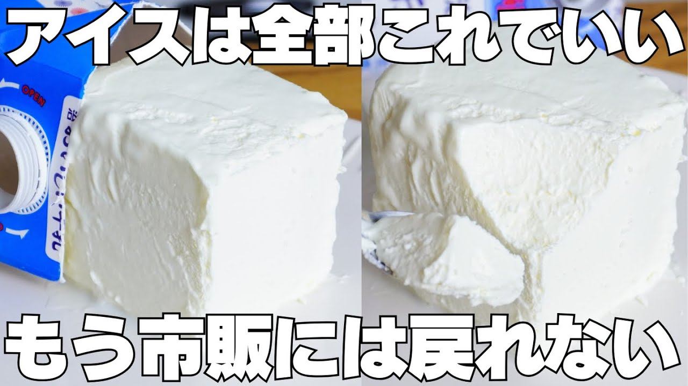

# 【材料2つ】パックに入れて固めるだけ！買うより安くて旨い！アイスクリーム作り方！

- 調べた日：2026-10-12（数字はいちばん新しい日の時点）
- チャンネル：syun cooking（@syuncooking、登録者 1,330,000人）
- 公開日：2026-08-21　長さ：6分37秒　形：横長
- 再生：2,105,055回（登録者の 1.6倍）　高評価：10,790　コメント：346
- URL：https://www.youtube.com/watch?v=Tdeun8ViDGo

## サムネ

## 人気のコメント（いいねの多い順・上から10個）

1. （いいね 505）こんばんは。 私は中学生からsyunさんのチャンネルを見つけて、パティシエになりたいと思うようになり、家族に動画で紹介されたお菓子や、本格レシピのスイーツを作ったり、syun さんのレシピ本二冊を誕生日プレゼントにもらいました。そんな私も高１です。いつもこのチャンネルのレシピに元気をもらっています😊 パティシエになれるようにがんばります！ 長文失礼しました。
2. （いいね 360）えっ？牛乳でアイスクリームを！？すげえ安くできるんだ！ 「牛乳は全部飲んで生クリームを入れてください」  まあ…そうだよね…
3. （いいね 307）普段練乳買わんからAIに聞いてみたら（牛乳450ml、生クリーム200ml、練乳30g）の合計金額の目安はスーパーでの購入でおよそ630円前後になるそうだ、アイスの箱二箱は買えるな、材料的に間違いなく美味いとは思うけど特別安くはないかな
4. （いいね 196）原材料を考えると今回はレディーボーデン買ってくる
5. （いいね 157）生クリームガッツリ使ってるアイスは絶対うまい
6. （いいね 149）高くて少ないだけの蓋付き牛乳パックについて、初めて実用的な使い方を見た。
7. （いいね 122）さすがに、生クリームそのものが高いし、量も少なめなので、市販品のアイスを買った方が安い気がします。
8. （いいね 98）やはりコスパがな 生クリームってそんだけでハーゲンダッツ買えるんよな
9. （いいね 65）いやいや 作る楽しさはあるけど生クリームの値段・・・
10. （いいね 54）生クリーム高いから安くはないと思うね。手間を考えたら買った方が安くて美味しいと思いました

## メモ（なぜ伸びた？ 視聴者は何を求めている？）

- 
