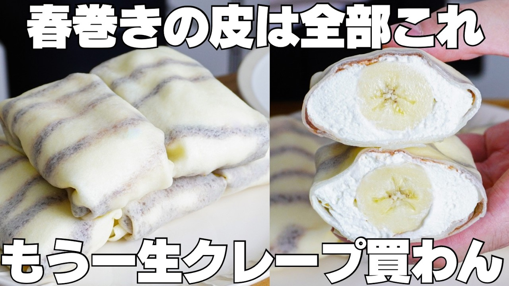

# 【材料4つ】レンジで20秒！買うより安くて旨い！春巻きの皮でクレープ作り方！

- 調べた日：2026-10-12（数字はいちばん新しい日の時点）
- チャンネル：syun cooking（@syuncooking、登録者 1,330,000人）
- 公開日：2026-09-04　長さ：8分08秒　形：横長
- 再生：786,138回（登録者の 0.6倍）　高評価：3,429　コメント：71
- URL：https://www.youtube.com/watch?v=o7TU56GVJko

## サムネ

## 人気のコメント（いいねの多い順・上から10個）

1. （いいね 34）春巻きの皮がクレープに早変わり、長い間クレープ食べてなかったので身近な食材でクレープが食べれるなんて感動です😊😊明日春巻きの皮を買いに行ってきて作ります✨⭐😋
2. （いいね 30）最近春巻きの皮やライスペーパーを使ったスイーツ見て来ましたが牛乳、コーヒー牛乳、生クリームで戻すのは初めて見ました👏 クオリティ高いのに簡単で美味しいとか最高😋💖✨
3. （いいね 28）春巻きの皮、焼売の皮、ワンタンの皮、餃子の皮選手権して欲しい
4. （いいね 22）偶然、余った春巻の皮があったのですぐに作ってみました！ 家族も絶賛するほど簡単で美味しかったです😋また今度好きな具材をいれてアレンジしてみます❤
5. （いいね 18）春巻きの皮と絞るだけホイップとバナナ🍌とチョコレートだけでクレープ美味しそうですね。ミルクレープも美味しそうですね。
6. （いいね 13）こんな簡単にクレープになるなんて、スゴすぎですね！お店の品みたい！
7. （いいね 11）以前、クレープの生地がうまく作れませんでした。 春巻の皮で作るの楽しみです。 ワクワクしながら作って食べたいです。
8. （いいね 10）小麦粉なので、加熱しなくても良い春巻きの皮なのか確認する必要はあります！ この見た目でクレープ思いつく人はおれど、小麦粉だから断念してるのかと…
9. （いいね 8）美味しそうですね🤤　アレンジ豊富で何種類か作りたくなりますね😀
10. （いいね 8）春巻きの皮にこんな使い道が… 普段はあまり買わないんですが、こういう風にスイーツにもなるなら買っていいですねぇ チョコバナナが何気に1番好きなのでこれは作りたいです コーヒー牛乳のも美味しそうで食べてみたいです 退院して元気になったら作りたいものが増えてしまって困ります笑

## メモ（なぜ伸びた？ 視聴者は何を求めている？）

- 
