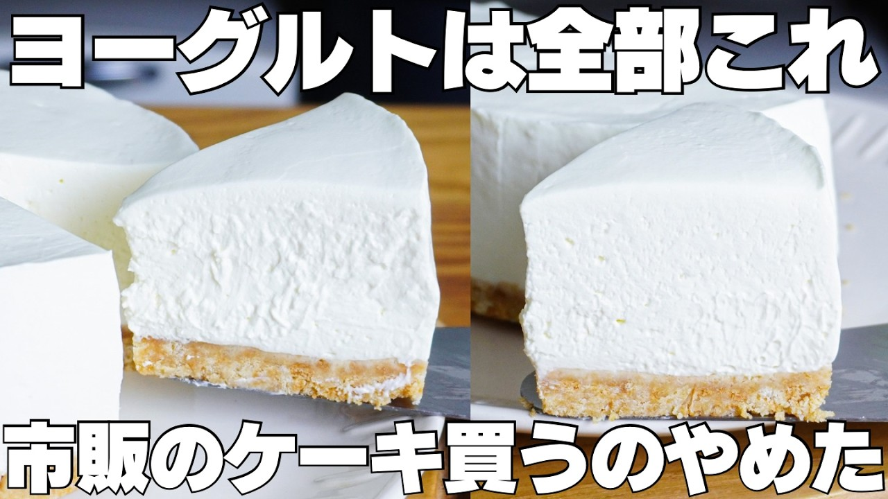

# 【材料3つ】混ぜて冷やすだけ！買うより安くて旨い！ゼラチン、バター不要！ヨーグルトレアチーズケーキ作り方！

- 調べた日：2026-10-12（数字はいちばん新しい日の時点）
- チャンネル：syun cooking（@syuncooking、登録者 1,330,000人）
- 公開日：2026-09-09　長さ：8分41秒　形：横長
- 再生：2,722,919回（登録者の 2.0倍）　高評価：11,719　コメント：118
- URL：https://www.youtube.com/watch?v=zuyAnyB7M6s

## サムネ

## 人気のコメント（いいねの多い順・上から10個）

1. （いいね 85）え、クリームチーズ無しでこんなに簡単に作れるなんて凄い。腸の病気で脂肪分が多い物が使えないから有難い！
2. （いいね 75）ヨーグルトレアチーズケーキは可愛く上品な見た目をしたスイーツです😊 クリームチーズを使わないでヨーグルトとホイップクリーム(生クリームと砂糖)でチーズ生地を作れることに私も驚いています！ いつもありがとうございます😊
3. （いいね 62）タイトルを理解した上で視聴したのに、え！ゼラチン使わないの！？え！バター使わないの！？ってなりました！材料少なくて最高！これは作るしかない！！
4. （いいね 59）初見です！違うバージョンのヨーグルトや、ケーキ型じゃなくてタッパー版も作ってくださり、すごくわかりやすい動画をありがとうございます😊✨
5. （いいね 55）美味しそうですね。ブルガリアヨーグルトを水切りして、絞るだけホイップで混ぜて、チョイスのクッキーと混ぜて、型にクッキーを平らにして、ブルガリアヨーグルトとホイップの混ぜたのを流し混む。後は、冷やすだけ　簡単ですね。😮
6. （いいね 54）絞るだけホイップは添加物すごそう、、
7. （いいね 46）私なら市販のチーズケーキ買ってしまう、しかしこういうのを誰かの為に作ってくれるひとは心優しいひとなんだろうな～
8. （いいね 39）choiceをチョイス👍
9. （いいね 35）40年くらい前に友達が作ってくれたのと同じ。ずっと忘れてました。懐かしいレシピあリがとうございます。
10. （いいね 35）おはようございます😊 ゼラチンとバター無しでレアチーズケーキが作れるのはいいですね👏👍 作ります😊 「CHOICEをチョイス」そのフレーズ好きです😊

## メモ（なぜ伸びた？ 視聴者は何を求めている？）

- 
