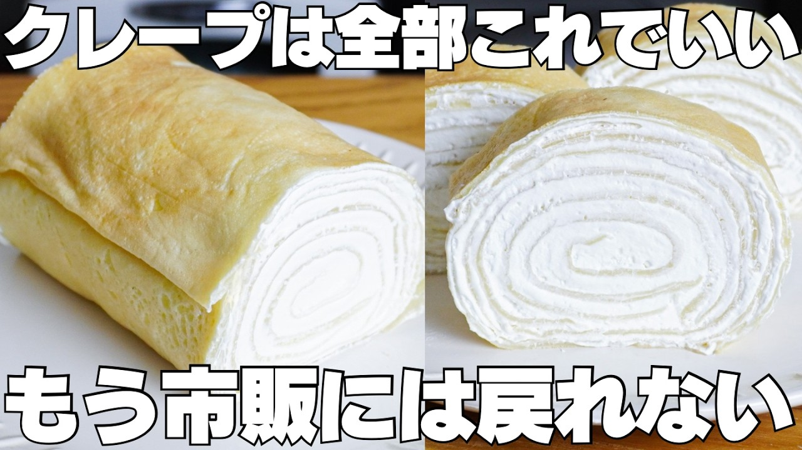

# 【材料3つ】1枚6円！重ねて丸めるだけ！卵、バター、牛乳不要！もちもちロールクレープ作り方！

- 調べた日：2026-10-12（数字はいちばん新しい日の時点）
- チャンネル：syun cooking（@syuncooking、登録者 1,330,000人）
- 公開日：2026-09-11　長さ：8分49秒　形：横長
- 再生：971,587回（登録者の 0.7倍）　高評価：3,680　コメント：83
- URL：https://www.youtube.com/watch?v=QW_CCWl22fw

## サムネ

## 人気のコメント（いいねの多い順・上から10個）

1. （いいね 42）これをベースにブッシュ・ド・ノエルを作れば年輪が綺麗。
2. （いいね 21）肥るとか考えずにこういうの思いっきり頬張りたいわあああ
3. （いいね 19）こんばんは★ 2枚目巻いた処から巻終わりになったので、デカって思ってしまいました😅 これだけ大きければ満足出来ます😌 生地作りも簡単だし美味しそうですね😆🎶
4. （いいね 8）これも絶対に美味しいやつですね！毎回宣言通りの材料だけで作られていて本当にすごいです！
5. （いいね 8）これは嫌味でもなんでもなく単なる疑問なのですが、何故完成した品を皿で切るのでしょうか？ 皿や包丁が痛みますよね？ まな板が無いわけではないです、よね？ ただキーッというような音が苦手でいつも気になっていました。 完成間際に音をZE↑RO↓にしてるので別に改善する必要はないです。 他に気にしている方がいないようなので。
6. （いいね 7）でも作るのが時間かかるから、結局市販の買ってしまうんだよな😂😂
7. （いいね 6）真ん中に一本バナナ入れても美味そう (   ᐛ)ﾊﾞﾅﾅ
8. （いいね 5）作ってみたけど薄く焼くのがむずいッスね……頑張って作り続けます！
9. （いいね 5）もちもちロールクレープ！  プレーンの方にのホイップクリームにチョコを細かく砕いてパラパラとアレンジしてみよう︎︎と思います👍🏻
10. （いいね 4）ミルクレープにしちゃえば巻かなくてもいいね

## メモ（なぜ伸びた？ 視聴者は何を求めている？）

- 
