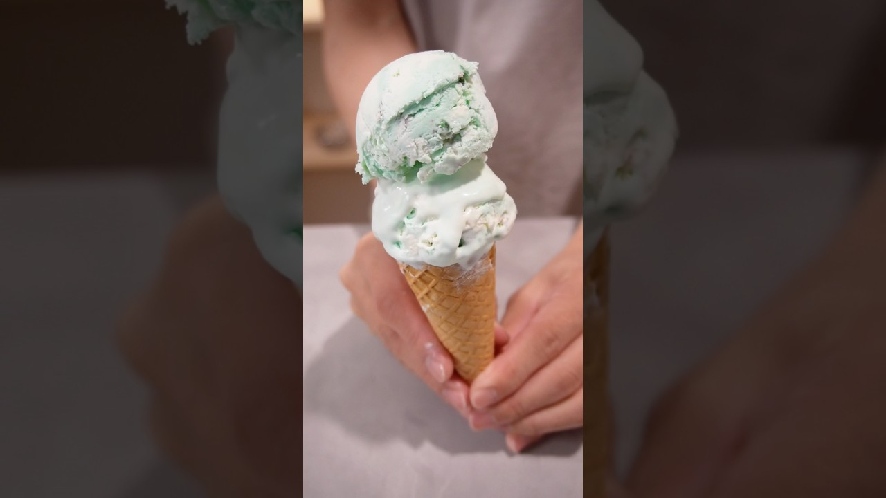

# ポッピングシャワー作ってみたら、、、#サーティーワン #ホッピングシャワー　#作り方　#簡単レシピ  #アイスクリーム

- 調べた日：2026-10-12（数字はいちばん新しい日の時点）
- チャンネル：とっしー（@tosshi-sweets、登録者 145,000人）
- 公開日：2026-08-01　長さ：1分01秒　形：ショート（縦長）
- 再生：5,111,891回（登録者の 35.3倍）　高評価：59,404　コメント：327
- URL：https://www.youtube.com/watch?v=BWCLyuK7S84

## サムネ

## 人気のコメント（いいねの多い順・上から10個）

1. （いいね 5,039）イチモツの不安としか聞こえなかったwww
2. （いいね 1,915）なんだよ…いちもつの不安って…
3. （いいね 1,852）ヘアバンドが前髪に見えてついにおかっぱデビューでもしたのかと思った笑笑
4. （いいね 1,006）一応レシピです 【レシピ】 生クリーム 200ml ホワイトチョコ　1枚 練乳　大さじ2 食紅の青と緑　適量 ミントのど飴　2個  ・ホワイトチョコを電子レンジで溶かして練乳を加えて混ぜる。 ・ミントのど飴で風味漬けした。生クリームを泡立てて、ホワイトチョコと混ぜる ・半分は緑色に着色する  パチパチパニック　2袋 ホワイトチョコ　4かけら 食紅の赤と緑　適量 ・ホワイトチョコに少量の水で溶いた食紅で着色する ・パチパチパニックを練り込んで、冷蔵庫で冷やし固める
5. （いいね 871）どこで生クリーム振ってんねんww
6. （いいね 805）びっくりした、、、イチモツの不安って言ったかと思った、、、
7. （いいね 240）何の不安だよ
8. （いいね 206）この雰囲気でまぁまぁ下ネタぶっ込んでくるのウケる
9. （いいね 101）初見です。生クリームの振り方にイチモツの不安を抱えておりましたが、次のシーンのセリフで確信に変わりました。ありがとうございました
10. （いいね 54）ホワイトドビュッシー定期

## メモ（なぜ伸びた？ 視聴者は何を求めている？）

- 
