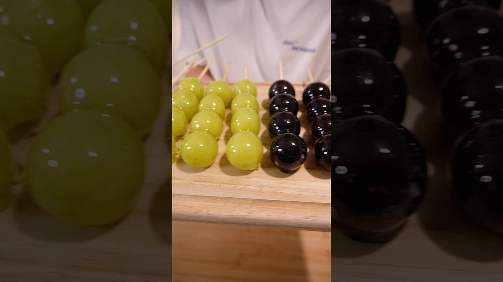

# 詳しい作り方とコツはコメント欄に！#ぶどう飴 #フルーツ飴 #簡単レシピ #手作りスイーツ #お菓子作り  #トレンド #飴

- 調べた日：2026-10-12（数字はいちばん新しい日の時点）
- チャンネル：とっしー（@tosshi-sweets、登録者 145,000人）
- 公開日：2026-09-10　長さ：1分01秒　形：ショート（縦長）
- 再生：3,350,746回（登録者の 23.1倍）　高評価：43,005　コメント：333
- URL：https://www.youtube.com/watch?v=LslBxemgEpI

## サムネ

## 人気のコメント（いいねの多い順・上から10個）

1. （いいね 12,121）皿でやったら割れました←当たり前だろ  おい待て、伸びすぎ。 ありがとう。
2. （いいね 4,040）耐熱容器じゃないやつに入れて割れたんだからコメントした人が悪いのにチーンなの？ しかも改善策あげてくれるとか素敵すぎ
3. （いいね 3,543）皿でやったら割れました🫣💦💫 なのか 皿でやったら割れました🫵😡💢 なのか
4. （いいね 1,943）次の動画、焼き型ではなくただの紙皿でやって「火傷しました」「燃えました」を予想。
5. （いいね 725）コツと注意点をまとめました↓ 【レシピ】 グラニュー糖　200g 水　　　　　　100ml お好みのフルーツ　適量  【注意点とコツ！】 ・分量を変えると加熱時間やムラが発生するため気をつけてください ・レンチン600W 10分30秒〜11分 ・レンチンしすぎると黄色く焦げるので様子を見ながら ・温度計で150〜160度が狙い目です ・混ぜるのは加熱する前の一回だけです。加熱後に混ぜると結晶化してしまい白くなりジャリジャリになってしまいます ・飴につける前にフルーツの水分をよく拭き取ってください。濡れていると弾かれます ・串2本分やったところで飴の温度が下がって固くなってしまうので、レンチン10〜20秒再加熱してください
6. （いいね 379）⚠️めっちゃ今思い出したので注意喚起⚠️昔グラタン用の耐熱のガラスでも砂糖溶かした時に割れた、、！前にアホか..と思ってコメント残したけど...自分もやってたの思い出した...。 調べたらグラタンの「オーブン庫内200度」は大丈夫でも直接べっとり液体化し、焦がすことを目的にした温度180〜200度のカラメルはNGらしい、、、 おおよそ耐熱容器の耐熱温度120度あたりだから割れることあるらしい！（見えない小さなヒビなども影響あるとのこと） 知らなかったぜ...。 耐熱容器のサイトにも注意喚起があった！  みんな、、鍋でやろうな..........（ズボラなワイ、何度か成功したが失敗を思い出し戻ってきた）  電子レンジのサイトにもモノによっては注意喚起があったヨ......
7. （いいね 251）当たり前だろばかじゃねーのって言わないの優しい
8. （いいね 244）なぜ耐熱か動画を確認しなかったのか疑問である…
9. （いいね 238）たまたま流れてきて美味しそーとか思って見てたらシャインマスカット食べたながら｢巨峰飴ニダ｣とか言うから思わず｢シャインマスカットな｣ってツッコんじゃったからコメ欄見たら触れてる人いなかった😂
10. （いいね 79）今までコップだったけど、熱湯で洗うの面倒だったからこれはいい！

## メモ（なぜ伸びた？ 視聴者は何を求めている？）

- 
