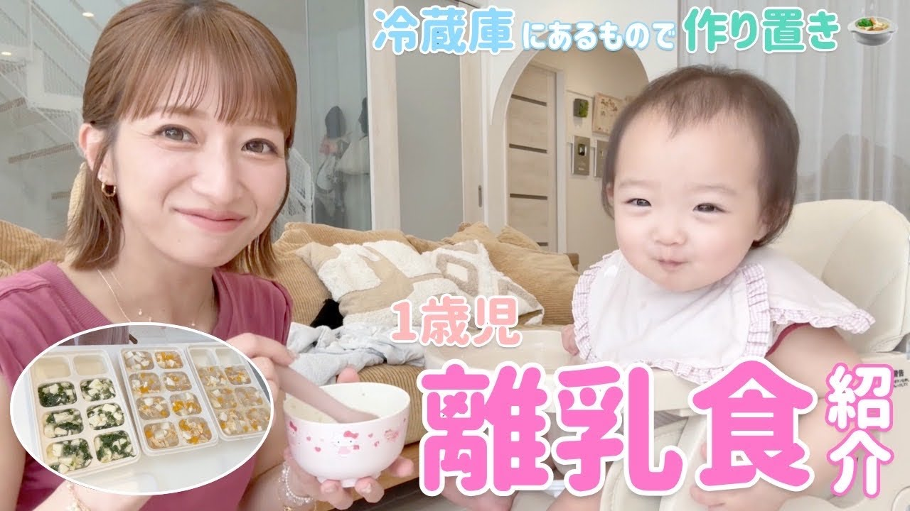

# 【離乳食作り置き】1歳になった夢のご飯を冷蔵庫にあるものでストック🍲15分2品の超時短調理⏰【大根とニンジンとしらすのとろみ和風スープ、豆腐とほうれん草の和風あんかけ】

- 調べた日：2026-10-12（数字はいちばん新しい日の時点）
- チャンネル：辻ちゃんネル（@tsujichannel_official、登録者 2,100,000人）
- 公開日：2026-09-27　長さ：22分31秒　形：横長
- 再生：1,561,721回（登録者の 0.7倍）　高評価：8,129　コメント：72
- URL：https://www.youtube.com/watch?v=VA2J7Bectm4

## サムネ

## 人気のコメント（いいねの多い順・上から10個）

1. （いいね 371）今年の8月に第一子を出産して、もともと好きで見てた辻チャンネルだったけど母になってから見る辻チャンネルは格別‼️やってる事がどれだけすごいことか…！
2. （いいね 207）夢ちゃん、なんて可愛いんだろー💕🩷いつも癒しをありがとう
3. （いいね 143）やる気でない時は、辻ちゃんねるかけて一緒に料理や掃除してます！🧼 可愛い格好とメイクまではやれない😇 メガネとボサボサ頭でがんばるかぁ〜
4. （いいね 119）サムネの辻ちゃん×夢空ちゃん可愛すぎる🥰 辻ちゃんネルでしか得られない癒しがある‼!
5. （いいね 78）にっこり笑ってる二人が可愛い！！ 見てるこっちも癒されます💕
6. （いいね 75）本当に素敵なママで、子どもみんな幸せだね❤
7. （いいね 64）グーグルの提供ってすごいな😂
8. （いいね 57）いやぁー夢しゃん可愛いすぎだよね〜💗
9. （いいね 51）夢ちゃんが離乳食食べてる時 お椀を床に置くのは良くないかも… 子供が自分で握る用と、親が食べさせる用のスプーン2本を用意するといいですよ🥄
10. （いいね 45）1歳でお茶碗2つ分は少なくない？夢ちゃんに食べさせるとき、大人がフーフー冷ますのやめた方がいいですよ〜！虫歯菌がうつるので、小さい扇風機で冷ましてみてください😌

## メモ（なぜ伸びた？ 視聴者は何を求めている？）

- 
