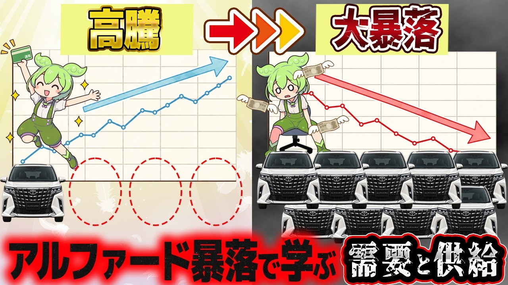

# 残クレで大暴落したアルファードで経済を学ぶのだ【ずんだもん解説】

- 調べた日：2026-10-12（数字はいちばん新しい日の時点）
- チャンネル：ずんだもん末路ストーリー（@zunda-matsuro、登録者 197,000人）
- 公開日：2026-09-17　長さ：15分09秒　形：横長
- 再生：366,003回（登録者の 1.9倍）　高評価：1,594　コメント：282
- URL：https://www.youtube.com/watch?v=csgibyeVQ18

## サムネ

## 人気のコメント（いいねの多い順・上から10個）

1. （いいね 279）ここ最近のオープニング替え歌が神懸かってる
2. （いいね 159）残クレアルファード略してザード
3. （いいね 155）週末のイオンモールで「アルファード」に乗り込む「腕にガッツリ入れ墨」の金髪兄ちゃんを目撃して「ホンモノの5,000円さんや！」と心の中で叫ぶほど感動した。
4. （いいね 100）このチャンネルのマイルドヤンキーが理解度高い伸びしろマジ卍男だから毎度おもろい
5. （いいね 99）最近このネタ多いけどやっぱ、このずんだもんだな！
6. （いいね 83）3年も乗り回して買った値段で売れると思うのがおかしいんよ
7. （いいね 68）お先真っくら寿司は草 バラン生える
8. （いいね 56）ヤンキーの頭良くなったと思ったら最後馬鹿に逆戻りで草
9. （いいね 51）最近動画編集始めたけど、この編集の労力を考えたらマジで凄いわ
10. （いいね 47）わナンバーで草 残クレ＝レンタカーってことか

## メモ（なぜ伸びた？ 視聴者は何を求めている？）

- 
