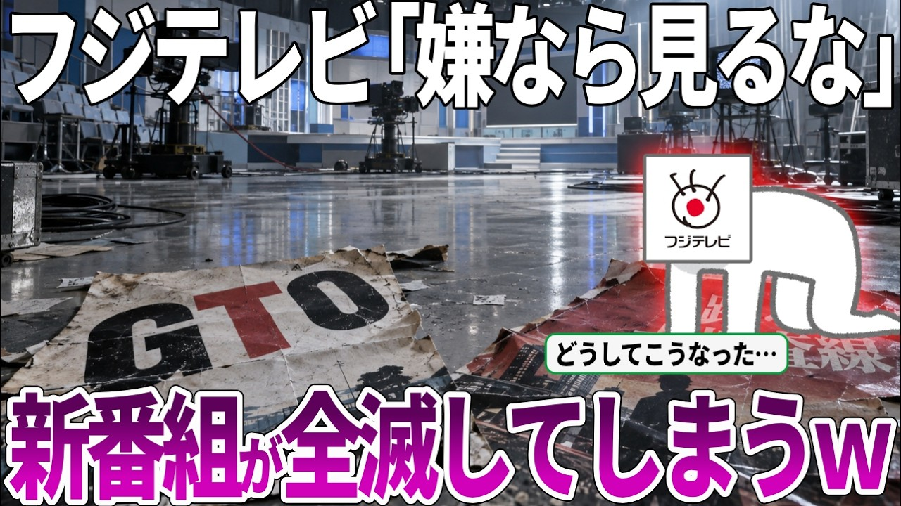

# フジテレビ新番組が全滅で視聴率1%台を連発！視聴率低迷でシンボルの絵画を売却か！？文春に不祥事をリークされ絶望的状況へ…【ずんだもん・ゆっくり解説】

- 調べた日：2026-10-12（数字はいちばん新しい日の時点）
- チャンネル：えだまめライフ（@zunda_navi88、登録者 20,100人）
- 公開日：2026-09-15　長さ：15分43秒　形：横長
- 再生：112,048回（登録者の 5.6倍）　高評価：1,153　コメント：353
- URL：https://www.youtube.com/watch?v=yc8tyCyjj5I

## サムネ

## 人気のコメント（いいねの多い順・上から10個）

1. （いいね 299）昔、誰かが言った「嫌なら見るな」がホントに現実化してしまうとはな．．．．
2. （いいね 285）岡村「嫌なら見るな！」 俺たち「はい( -_-)」
3. （いいね 180）嫌なら見るなと言われたので、つまらんし、嫌なので見ません。
4. （いいね 177）「ふざけるな」は国民のセリフだ馬鹿
5. （いいね 165）嫌なら見るなあたりからはマジでテレビみてないなぁ。
6. （いいね 138）「驕れる者は久しからず」「盛者必衰の理」 正に平家物語の一節そのままですね
7. （いいね 135）バカは死んでも治らない・・・不治テレビｗｗｗ
8. （いいね 123）もう天気予報と緊急地震速報だけ放送してろ。
9. （いいね 107）あ、いまフジってそんな出し物してたんだ。全く興味がわかない
10. （いいね 84）社会悪みたいなもんだな 何時までも放送免許を与え続けてる事が異常

## メモ（なぜ伸びた？ 視聴者は何を求めている？）

- 
