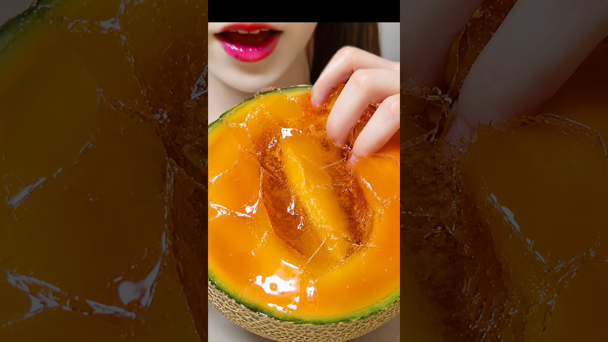

# メロンパキパキスクイーズ作ってみた🍈 #asmr #お菓子作り #スクイーズ #スライム

- 調べた日：2026-10-12（数字はいちばん新しい日の時点）
- チャンネル：きり （@きりasmr-b3f、登録者 72,100人）
- 公開日：2026-08-26　長さ：1分07秒　形：ショート（縦長）
- 再生：794,758回（登録者の 11.0倍）　高評価：16,590　コメント：187
- URL：https://www.youtube.com/watch?v=V2m8_0ckWSw

## サムネ

## 人気のコメント（いいねの多い順・上から10個）

1. （いいね 1,111）スライムパキパキみたい きりさんやっぱりネッチョリ系好きやね笑
2. （いいね 971）マジで偽物の種がいい味出してる
3. （いいね 718）スクイーズっていうから粘土か何かだと思ってたらいきなり食べだしてビビったw
4. （いいね 493）メロンとスイカバージョンどっちの方がパキパキ成功してる？🍉🍈
5. （いいね 273）リアルなスクイーズ？なのかと思ってたら食べ始めてびっくりした笑
6. （いいね 254）色変わってんの熟したみたいで美味しそう
7. （いいね 132）だから日本人ってなんでも食べると思われてるのか… うまそ〜〜〜！！！！
8. （いいね 89）なんかいろが変化してる？！ ぱりぱりかりかりでいい音〜
9. （いいね 34）美味しそう！パキパキいい音過ぎる！毎回思うけどレベルがやばい
10. （いいね 31）まってクオリティ高すぎて声出た

## メモ（なぜ伸びた？ 視聴者は何を求めている？）

- 
