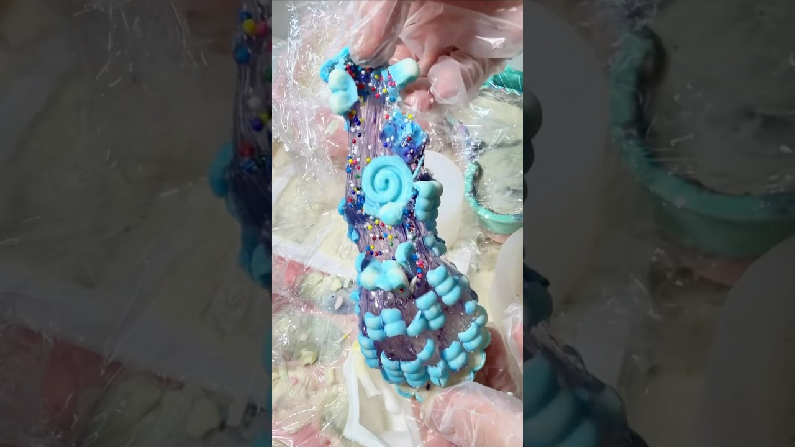

# 10時間かけて作った大量の水飴チョコ開封してみた💎#お菓子作り #料理 #お菓子 #食べ物

- 調べた日：2026-10-12（数字はいちばん新しい日の時点）
- チャンネル：きり （@きりasmr-b3f、登録者 72,100人）
- 公開日：2026-09-06　長さ：1分49秒　形：ショート（縦長）
- 再生：808,952回（登録者の 11.2倍）　高評価：13,916　コメント：76
- URL：https://www.youtube.com/watch?v=Loy6gUgA8dM

## サムネ

## 人気のコメント（いいねの多い順・上から10個）

1. （いいね 341）10時間もかかるのに作ろうと思ったの凄い‼️色んな形あってめっちゃすごい✨️食べる動画楽しみ😊☺️
2. （いいね 323）ヤバァイ結構早く見れた 最初のドーナツ色合い可愛すぎるううう  追記 300いいね👍ありがとうございます❣️
3. （いいね 86）えめっちゃ早くね？！剥がす音ってこんな気持ちいいんだ…あと器用すぎん？私だったら全部砕けてるw
4. （いいね 40）大きいのが多くて食べる時大変かも😂マンゴー🥭めっちゃいい感じ食べる動画楽しみ😊
5. （いいね 18）グラデーションがうますぎる！！ 食べる動画も楽しみにしてます！！
6. （いいね 12）きりさん見応えあって辞められない
7. （いいね 5）大きいのに成功してるの凄すぎるし自分では絶対作らないてか作れないものを作ってくれて感想もくれるからまじでありがたいし嬉しい！！ 飲み込んでる音（？）が好きなので飲み込んでるシーンも入れて欲しいです✨
8. （いいね 4）マジで食べて見たい〜❤
9. （いいね 4）キティバッキバッキで死😂
10. （いいね 3）カイフーの音も好き😻❣️❤    食べてるしょしゃこーんも好き😻❣️❤

## メモ（なぜ伸びた？ 視聴者は何を求めている？）

- 
