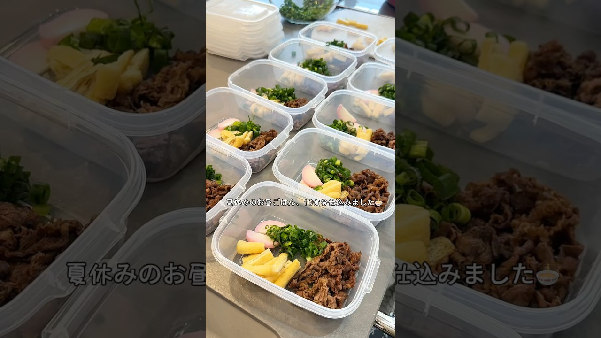

# 夏休みのお昼ごはん、毎日どうしよう😂冷凍うどんの具材を10食分仕込みました🍜帰ってきてすぐ食べられるように準備しておくと、バタバタする日も少し安心🌿 #昼ごはん #作り置き #冷凍ストック

- 調べた日：2026-10-12（数字はいちばん新しい日の時点）
- チャンネル：しょうまま（@しょうまま-lifestyle、登録者 158,000人）
- 公開日：2026-08-06　長さ：1分30秒　形：ショート（縦長）
- 再生：3,236,714回（登録者の 20.5倍）　高評価：28,219　コメント：277
- URL：https://www.youtube.com/watch?v=aByiz8Q30ho

## サムネ

## 人気のコメント（いいねの多い順・上から10個）

1. （いいね 2,731）このタッパー達が、冷凍庫に余裕で入るスペースがあるのも素晴らしい。
2. （いいね 964）ここ、ママさん達が圧倒的に多いと思うけど、ひとりモンも興味深く観てます。このストックうどんとか超!参考になります😊
3. （いいね 634）冷凍庫って、化石の宝庫になっちゃうんだけど、こちらのお宅は整ってるなぁ。すごい。
4. （いいね 605）レンジ前待機してる息子くんかわいすぎる！！
5. （いいね 496）同じサイズのタッパーがこんなにあるの 凄い😂
6. （いいね 424）本当にどうしてそんなに素敵なの？ 理想過ぎる...！
7. （いいね 418）ほんと、いいお母ちゃま😂すごく好きな動画の一つ
8. （いいね 383）まず、この用量がはいる冷蔵庫などがあるのか羨ましい。この人の料理って、本当に無駄がなく楽しくて素晴らしい。 毎日のご飯が楽しみになってしまう。
9. （いいね 218）冷凍食品に頼らないところ素晴らしい👏
10. （いいね 181）これは真似したい❗️ 塾の前後の夜ごはんにも良さそう✨　 息子さんも可愛くて癒されます💕

## メモ（なぜ伸びた？ 視聴者は何を求めている？）

- 
