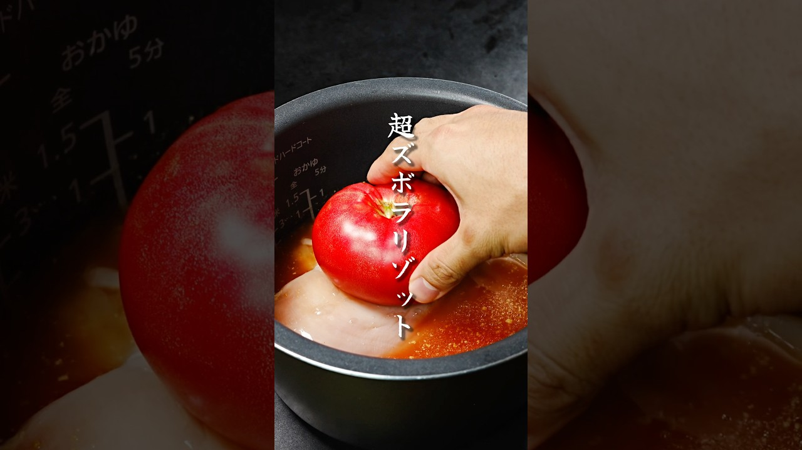

# 炊飯器にぶち込むだけでできる超ヘルシーズボラリゾットの作り方

- 調べた日：2026-10-12（数字はいちばん新しい日の時点）
- チャンネル：だれウマ【料理研究家】（@だれウマ料理研究家、登録者 1,930,000人）
- 公開日：2026-08-12　長さ：1分54秒　形：ショート（縦長）
- 再生：4,656,752回（登録者の 2.4倍）　高評価：8,874　コメント：61
- URL：https://www.youtube.com/watch?v=Wj2uMgG7tJs

## サムネ

## 人気のコメント（いいねの多い順・上から10個）

1. （いいね 51）これはもうちょっと早く知れたら今日の晩飯だったな
2. （いいね 43）え！ じゃあオムライスが最強って事⁉︎
3. （いいね 26）いつもギャグセン以外は完璧なんだよなー
4. （いいね 16）鶏皮に含まれるグリシンは睡眠の質を高める効果があるっぽいので、ぐっすり眠りたい時はライバルに鶏皮あげないでおきましょう☆
5. （いいね 11）鶏入れてみてね！ってことか。  ごめんなさい（）  最近目が覚めるのが早過ぎてなぁ。
6. （いいね 10）お盆8連勤しんどすぎたけどこれ簡単すぎて美味しすぎた。ありがとう、マッチョ。
7. （いいね 7）思わずせ〜のの後「ライバルにあげましょう」はもってしまったww
8. （いいね 7）コレは体力限界でも作れそう😊
9. （いいね 6）え！米一合に鶏むね肉１枚使うの？凄い贅沢リゾットだ〜〜！
10. （いいね 6）二合の場合はどうすればいんやろ？ 全部2倍？

## メモ（なぜ伸びた？ 視聴者は何を求めている？）

- 
