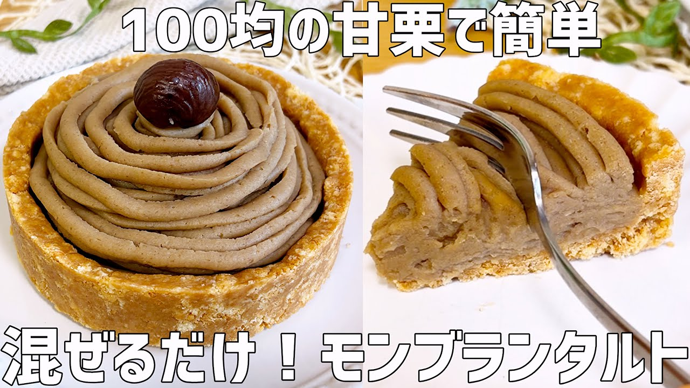

# 【混ぜるだけ】100均の甘栗で作る！濃厚モンブランタルト〜材料4つだけ〜

- 調べた日：2026-10-12（数字はいちばん新しい日の時点）
- チャンネル：どーなつ子（@どーなつ子、登録者 83,600人）
- 公開日：2026-09-25　長さ：8分01秒　形：横長
- 再生：377,474回（登録者の 4.5倍）　高評価：1,523　コメント：42
- URL：https://www.youtube.com/watch?v=8CncHF8l7Qg

## サムネ

## 人気のコメント（いいねの多い順・上から10個）

1. （いいね 18）へぇタルト生地牛乳で行けるんですね～ こういうのだいたいバターとかで固めてる？イメージが強かったです。 サツマイモとかカボチャとかでも美味しそうだ
2. （いいね 15）もしかしたら 栗だけもしくは栗と砂糖だけで先に混ぜて ペースト状にしてから牛乳投入したら 早くなじんで牛乳が飛び散りにくいかもしれません
3. （いいね 10）モンブランクリーム、けっこうたくさんできますねー😍😍✨✨  個人的にはホイップ入りのモンブランが好きだから、中に絞るだけホイップを入れて、上にたっぷりモンブランクリームでも良いかもと思いましたー😍😍✨✨ 参考にさせていただきますー✨✨
4. （いいね 7）動画を見ました。 「モンブランタルト」。 秋のスイーツですね。 個人的に好きなスイーツです。 コーヒーと一緒に。
5. （いいね 7）お聞きしたいのですが フードプロセッサーが無い場合は、作るの難しいですか？
6. （いいね 6）ケーキ型はどちらの物をお使いなのでしょうか？ 教えていただけると助かります🥺🙏
7. （いいね 4）ん～　美味しいそぅですね🎵😊　秋のスイーツって感じですよ🎵 ちょうど　昨日栗を買ってきてるので作ってみますね😊  後　そちらで売ってる 一袋の生栗🌰の値段はいくら位ですか？
8. （いいね 3）去年、初めてモンブラン作りに挑戦して大失敗したので、こちらの動画を参考にさせていただきモンブランリベンジします🌰
9. （いいね 3）モンブラン美味しそうですね。凄いタルトケーキ🍰
10. （いいね 3）これは早速作りたいと思いました❣️タルトの部分は冷蔵庫でどのくらい冷やし固めたら良いのでしょうか❓🌰

## メモ（なぜ伸びた？ 視聴者は何を求めている？）

- 
