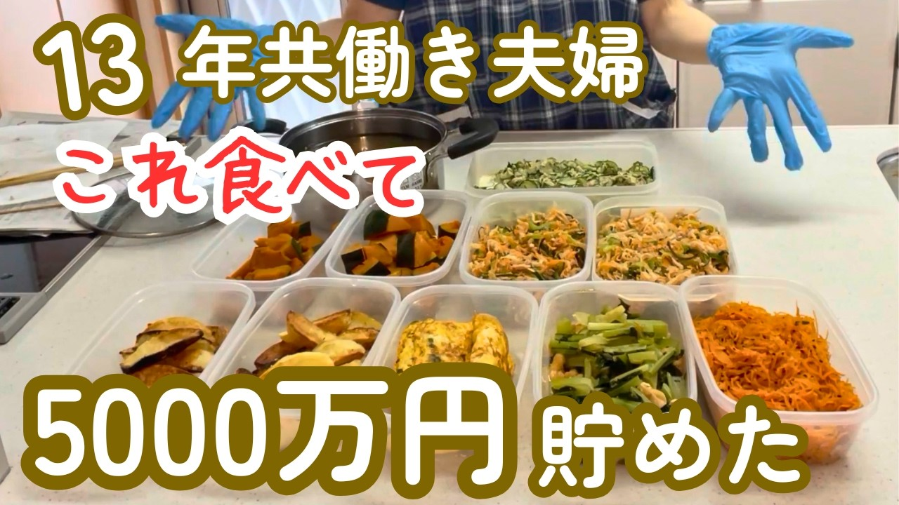

# 【本気で貯めたい方へ】13年続けた！4人家族のリアルな1週間晩ごはん／食費はケチり過ぎない！／日本の農業を支えたい

- 調べた日：2026-10-12（数字はいちばん新しい日の時点）
- チャンネル：ココロ踊る節約LIFE（@ココロ踊る節約life、登録者 11,900人）
- 公開日：2026-07-16　長さ：18分24秒　形：横長
- 再生：238,484回（登録者の 20.0倍）　高評価：815　コメント：59
- URL：https://www.youtube.com/watch?v=2nqYl8Ei6j0

## サムネ

## 人気のコメント（いいねの多い順・上から10個）

1. （いいね 63）すごくいいと思いますが、家族から不満がうまれないのも凄いと思います👏
2. （いいね 30）作り置きした物は 痛まないのか、心配です。自分で、作ると金曜日までは持ちません😢
3. （いいね 18）これが出来たら苦労しないよなぁ😂凄い‼️尊敬です！節約しないとなぁ😂😂😂
4. （いいね 17）とっても手早く食材無駄にしないの凄い尊敬します。卵焼きは冷凍するなら片栗粉入れるとパサつきにくいのでお勧めですよ😊
5. （いいね 9）冷凍食品とか、〇〇の素とか、惣菜買ってきたりとかしてないのが凄い。 わたしは作り置きを作るのすら面倒😅納豆、明太子、なめ茸ビンとかも1品とカウントしちゃう
6. （いいね 8）節約もすごいですが、なにより13年間も続けられたのがすごいと思います！！
7. （いいね 8）１週間冷蔵庫で保存で腐らないですか？
8. （いいね 6）素晴らしい👏
9. （いいね 6）我が家も作り置きです！自分の好きな料理&子どもたちの好きなものしか作らないから負担なく、毎週同じようなものを作っています。3000万までいきました！
10. （いいね 4）めちゃくちゃマメで尊敬します！ こう動画を見ていると作れたら楽しそうと思うのですが、料理が苦手すぎて1.2品作るだけで疲れ果ててしまいます。 連続で作り続けるにはどうすればいいんでしょうか？😂 また、作り置きのお弁当はこの時期痛んだりしませんか？😢

## メモ（なぜ伸びた？ 視聴者は何を求めている？）

- 
