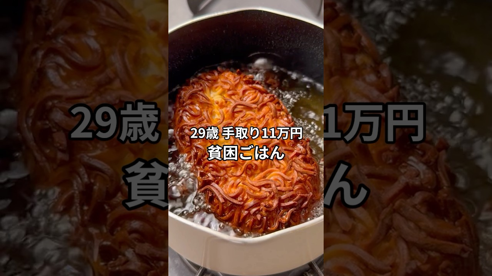

# 手取り11万29歳の貧困ごはん #貧困ごはん #ASMR #節約レシピ #節約飯 #男飯

- 調べた日：2026-10-12（数字はいちばん新しい日の時点）
- チャンネル：シュン | 手取り11万旦那（@シュン手取り11万旦那、登録者 63,500人）
- 公開日：2026-07-19　長さ：1分27秒　形：ショート（縦長）
- 再生：1,634,752回（登録者の 25.7倍）　高評価：12,622　コメント：468
- URL：https://www.youtube.com/watch?v=LAL83AQ-L1k

## サムネ

## 人気のコメント（いいねの多い順・上から10個）

1. （いいね 990）一瞬、11万29歳とかいう閣下みたいな年齢なのかと思った
2. （いいね 446）手取り11万で今の日本でどうやって生活を…てなんかもう日本政府に腹が立ってきて料理頭に入ってこないバグ😂
3. （いいね 367）うまそ…天才やん
4. （いいね 316）ボーナス貰えるんですね！よかった🥰 ジャガイモにチーズ抜群に合いますよね。 なかなか料理で冒険できなくて😧いつも楽しみに見ていますょ。
5. （いいね 121）外国人に生活保護13万円位とか止めるべき 医療費までただ 日本人には中々出さない この国はおかしな事ばかり
6. （いいね 94）ラーメンスープ味のポテサラ気になる 衣がザクザクして美味しそう
7. （いいね 81）ほんとは金持ってそう
8. （いいね 80）あかん 美味しそうなのにBGMで笑ってしまう
9. （いいね 70）嫁の手取50万、旦那パート主夫11万やな…
10. （いいね 66）手取り11万で結婚されてるのが尊敬します。

## メモ（なぜ伸びた？ 視聴者は何を求めている？）

- 
