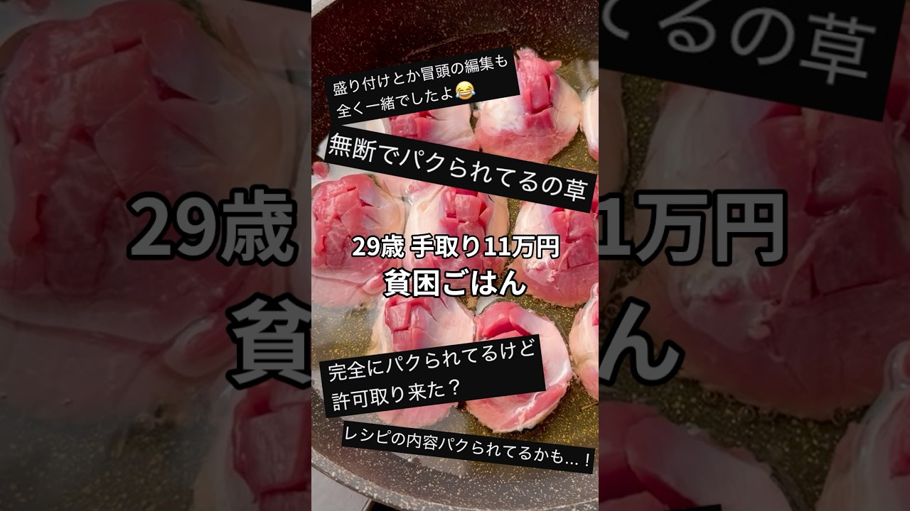

# 手取り11万29歳の貧困ごはん #貧困ごはん #ASMR #節約レシピ #節約飯 #男飯

- 調べた日：2026-10-12（数字はいちばん新しい日の時点）
- チャンネル：シュン | 手取り11万旦那（@シュン手取り11万旦那、登録者 63,500人）
- 公開日：2026-08-01　長さ：1分26秒　形：ショート（縦長）
- 再生：2,124,274回（登録者の 33.5倍）　高評価：26,444　コメント：629
- URL：https://www.youtube.com/watch?v=WRnKxdDy4hY

## サムネ

## 人気のコメント（いいねの多い順・上から10個）

1. （いいね 2,801）パクられた本人達からチクチクと苦言を呈されてる常習犯の彼らにパクられて『嬉しい』はイメージ的に言わない方がいいかと。 彼らのパクりは疑惑とかじゃなくて100%確定だから、遠慮なく『一言欲しかった』くらい言っても問題ないかと。 変に大人の対応をする必要のない、大人の対応をしない方がいい、常識的にどうしようもない相手ってのは居るんだからさ。
2. （いいね 2,426）ブルーシーじゃねって思ったら案の定で草
3. （いいね 2,305）パクられちゃったのは仕方ないしクソデカチャンネルに楯突く勇気も無いから俺たちは変わらずこのチャンネル応援しようぜ
4. （いいね 1,610）ブルーシーかなって思ったらやっぱりそうだった。ほんと学ばないよね
5. （いいね 872）ブルーシーはいたるところからパクってるからなぁ。 あまりプライドはないんだろうな。 再生回数多くとったらそれでいいんだろな。
6. （いいね 813）砂肝、この調理の仕方で子供たちに出したら硬いの苦手だったり内臓系あまり食べないはずなのにパクパク食べてます。 ありがとうございます。
7. （いいね 741）海外の動画は普通にパクるし、日本でもリスペクトなく平気でぱくんるだけど、登録数が多すぎるせいでパクられた側が気を遣って「驚いたけど嬉しいです」とか忖度せざるを得ない そんなわけないじゃん自分が考えたコンテンツパクられて めちゃくちゃ悪質だよねブルーシー
8. （いいね 628）誰のこと言ってるのか分からん…
9. （いいね 554）ブルーシーだと思ったらやっぱりブルーシーだった。嬉しいって書いてるけど再生数の踏み台にされてるだけからね…
10. （いいね 431）色々な料理動画が沢山あるけどこのチャンネルの独特な雰囲気はクセになる

## メモ（なぜ伸びた？ 視聴者は何を求めている？）

- 
