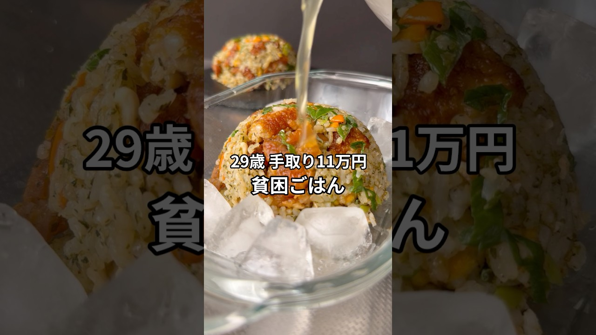

# 手取り11万29歳の貧困ごはん #貧困ごはん #ASMR #節約レシピ #節約飯 #男飯

- 調べた日：2026-10-12（数字はいちばん新しい日の時点）
- チャンネル：シュン | 手取り11万旦那（@シュン手取り11万旦那、登録者 63,500人）
- 公開日：2026-08-23　長さ：1分36秒　形：ショート（縦長）
- 再生：2,092,616回（登録者の 33.0倍）　高評価：20,727　コメント：493
- URL：https://www.youtube.com/watch?v=y9xHMqNkrYk

## サムネ

## 人気のコメント（いいねの多い順・上から10個）

1. （いいね 2,802）もはやただの貧乏飯ではなくなっている 金をかけない超絶リッチ飯w
2. （いいね 1,316）シュンさんはお子さんほしいのですか？ 奥さんはどう考えてるのでしょう。 産むのは奥さんですし、周りに言われて決めるのは違う気がします。 シュンさんと奥さんがほしいのであれば、お互い納得の行くタイミングで迎えられると良いですね😌
3. （いいね 1,009）急に丁寧語だなと思ったら、お茶のチャーハン・おチャーハンだった。今度作ってみたい
4. （いいね 868）まあ何はともあれ、手取り11万で子供は無理だよなあ。
5. （いいね 408）極貧売りするにはすべてに清潔感が漂いすぎてるんだよな
6. （いいね 281）最近この手の動画まじ増えたよな ホンマか偽りかわからんけど
7. （いいね 256）そういえば祖母はお茶漬けの素で作っていました。本当はすごく美味しいのです。
8. （いいね 221）貧困ご飯じゃなくて無駄のないごはんみたいなニュアンスにしたらいいのに！
9. （いいね 190）無理して子供作ることないと思いますよ。夫婦2人で幸せなら尚更。子供一人で夫婦仲も変わってしまいますし
10. （いいね 104）あなたの人生は親父のものではありません。あなたの人生は100%あなたのものです。親父の意見は参考程度でいいと思います。一度きりの人生、後悔無きよう。

## メモ（なぜ伸びた？ 視聴者は何を求めている？）

- 
