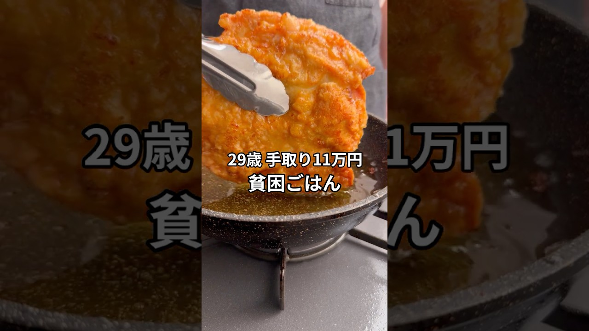

# 手取り11万29歳の貧困ごはん #貧困ごはん #ASMR #節約レシピ #チキン南蛮 #節約

- 調べた日：2026-10-12（数字はいちばん新しい日の時点）
- チャンネル：シュン | 手取り11万旦那（@シュン手取り11万旦那、登録者 63,500人）
- 公開日：2026-09-05　長さ：1分30秒　形：ショート（縦長）
- 再生：1,121,305回（登録者の 17.7倍）　高評価：17,708　コメント：436
- URL：https://www.youtube.com/watch?v=b1tzJwyjvT4

## サムネ

## 人気のコメント（いいねの多い順・上から10個）

1. （いいね 1,508）貧困御飯ちゃうやん、立派な御飯です。
2. （いいね 1,072）こんなに手間かけられる時間があることがもはや裕福な気がしてくる昨今
3. （いいね 549）170円ってどんな計算だよ笑笑
4. （いいね 469）みじん切りのやり方天才すぎる！！！
5. （いいね 170）タルタルソースは卵を使って、揚げる時に漬ける卵はマヨネーズで代用するとコクと旨味が増して節約出来て良いですよ😊
6. （いいね 126）玉ねぎの皮をスープにするのは初めて見た。
7. （いいね 101）旦那がダイエット中だから豆腐タルタル作ってみよ！
8. （いいね 89）貧困ごはんではなく節約レシピで。物価高騰してるので参考になります。
9. （いいね 83）ただの豪華なゴハンやんけ
10. （いいね 68）調理の丁寧な工程だけでなく無駄なく食材を使い切る行為までもが美しい 曲も相まって荘厳な感じがします

## メモ（なぜ伸びた？ 視聴者は何を求めている？）

- 
