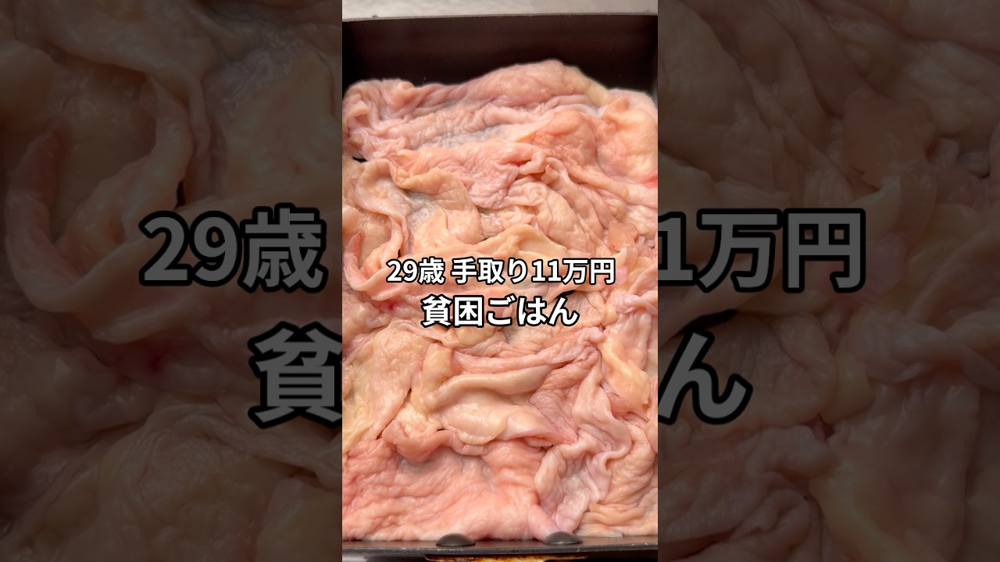

# 手取り11万29歳の貧困ごはん #貧困ごはん #ASMR #節約レシピ #ペペロンチーノ  #節約

- 調べた日：2026-10-12（数字はいちばん新しい日の時点）
- チャンネル：シュン | 手取り11万旦那（@シュン手取り11万旦那、登録者 63,500人）
- 公開日：2026-09-12　長さ：1分40秒　形：ショート（縦長）
- 再生：895,600回（登録者の 14.1倍）　高評価：9,441　コメント：231
- URL：https://www.youtube.com/watch?v=B2NUM-EFXD0

## サムネ

## 人気のコメント（いいねの多い順・上から10個）

1. （いいね 543）仕事から帰って来たら旦那さんがご飯作ってくれてるの、良いなあ… あるモノで代用したり食材を無駄なく使ってるところ尊敬します😊
2. （いいね 225）この人の動画ってこの間のタルタルもそうだけど 新たな発見あるから見てて本当におもしろいよね
3. （いいね 212）なんでこんな「全員で死力を尽くしたけど助ける事ができなかった」みたいなBGMなんだよ
4. （いいね 82）ちょっと美味しかった、って表現素敵
5. （いいね 80）医療介護分野であることを小出しに教えてくれるのありがたい。
6. （いいね 62）豆苗とピーマンの万能感🫑
7. （いいね 60）ピーマンの種、唐辛子の代用できたんですね！！？ いいことを知りましたー！！！ 色々学ばさせてもらってます！🙇🏻‍♀️‪‪
8. （いいね 48）こう言う手間がかかった料理ってご馳走だよね。 これぞ贅沢の極み👍
9. （いいね 30）このかたの斬新なセンスと食材余すことなく使う感じほんとリスペクト
10. （いいね 28）貧困ごはんなんてとんでもない、世界一豊かな食卓ですわ！

## メモ（なぜ伸びた？ 視聴者は何を求めている？）

- 
