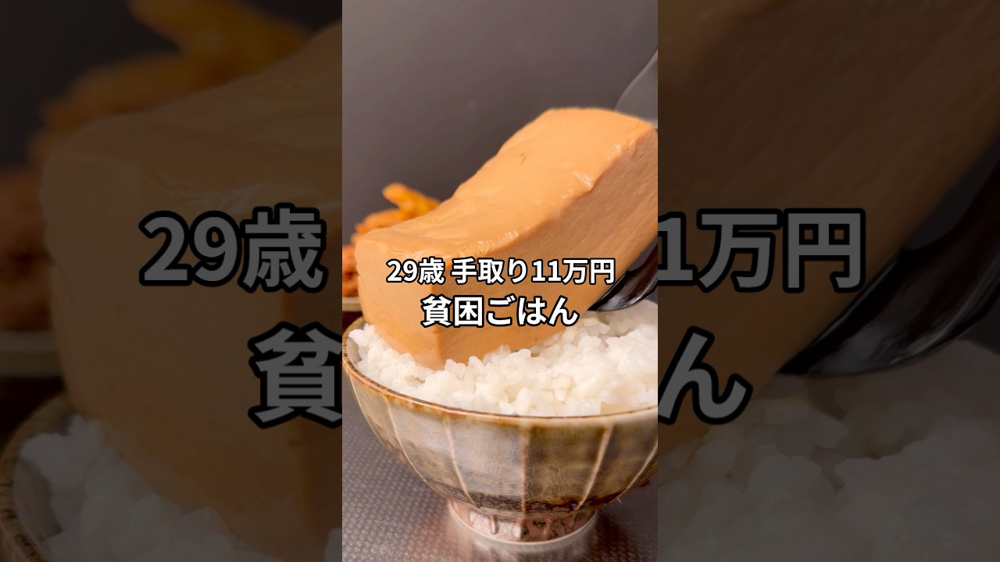

# 手取り11万29歳の貧困ごはん #貧困ごはん #ASMR #節約レシピ #豆腐レシピ #とうめし

- 調べた日：2026-10-12（数字はいちばん新しい日の時点）
- チャンネル：シュン | 手取り11万旦那（@シュン手取り11万旦那、登録者 63,500人）
- 公開日：2026-09-20　長さ：1分05秒　形：ショート（縦長）
- 再生：3,921,483回（登録者の 61.8倍）　高評価：62,906　コメント：864
- URL：https://www.youtube.com/watch?v=x3oEkFTXeUU

## サムネ

## 人気のコメント（いいねの多い順・上から10個）

1. （いいね 3,831）豆腐ナゲット普通に美味そうでめっちゃ食べてみたい😭😭 貧困学生すぎてちょうど今絶食2日目だったからこういうレシピ知れるのありがたすぎるよ  【追記】 豆腐ナゲット実際に作ってみましたが、揚げてるからなのか豆腐感全く無くてほんとに美味しかったのでみなさん絶対作ってみてください！スナック感覚でバクバク行けますよ
2. （いいね 3,134）ホットサンドメーカーの汎用性を知れたよ
3. （いいね 1,751）レシピを残してみます。 ▼とうめし 　・醤油大さじ2 　・砂糖小さじ1 　・みりん/酒大さじ2 　・顆粒だし小さじ1 　・絹豆腐 タレに豆腐を15〜30分ほど付ければ完成です。 ▼豆腐ナゲット 　・卵 　・片栗粉大さじ3 　・鶏ガラ小さじ2 　・醤油大さじ1 　・お好みで胡椒 木綿豆腐を混ぜこんで焼き上げれば完成です。
4. （いいね 1,320）ホットサンドメーカーで米炊こうという発想ある時点で天才
5. （いいね 1,074）にしてもキッチンが綺麗すぎる。毎日拭いてるんやろなぁ
6. （いいね 982）豊かさについて考えさせられますね しあわせそう
7. （いいね 359）この曲聞いたら、バシャウマの失敗飯しか思い浮かばない俺はバシャウマに侵されている
8. （いいね 221）豆腐ナゲットとかいう存在を初めて知った😮 美味しそう😋
9. （いいね 192）BGMこれじゃなくていいんじゃね？ 楽しんでるのが伝わってくるよ！
10. （いいね 153）今後収入や利益が上がっても、この動画の系統で続けて欲しいです！

## メモ（なぜ伸びた？ 視聴者は何を求めている？）

- 
