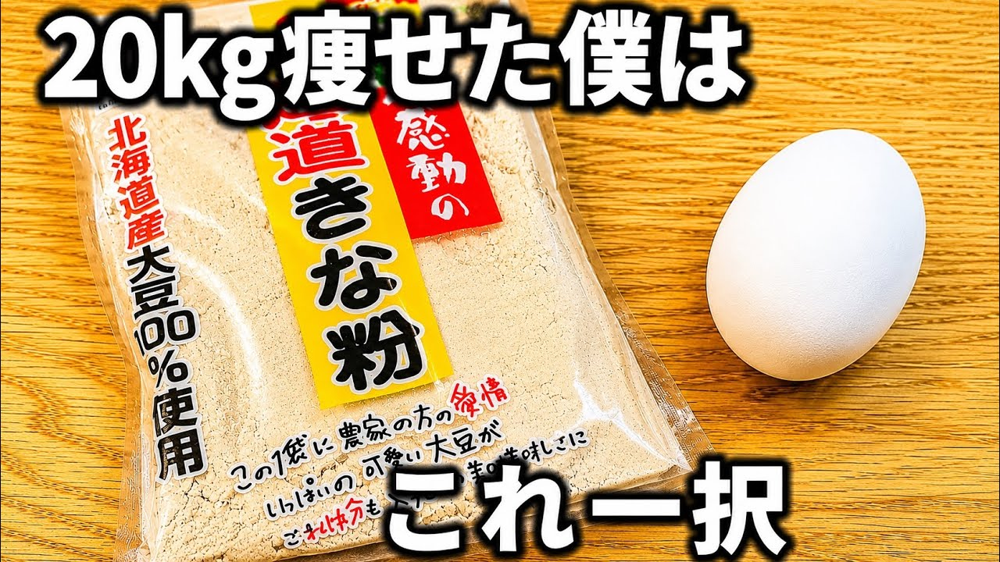

# 【レンジで簡単】きな粉と卵で健康蒸しパン！ダイエット中のおやつや朝食に！タッパーで簡単！早くて美味い！

- 調べた日：2026-10-12（数字はいちばん新しい日の時点）
- チャンネル：毎日痩せレシピ【料理講師の健康ダイエットch】（@ズボラでも20kgダイエットしたレシピ、登録者 6,820人）
- 公開日：2026-08-30　長さ：1分23秒　形：横長
- 再生：374,699回（登録者の 54.9倍）　高評価：1,960　コメント：39
- URL：https://www.youtube.com/watch?v=aRCf0Hj8RSg

## サムネ

## 人気のコメント（いいねの多い順・上から10個）

1. （いいね 17）すぐ作ろうときな粉買ってきました。 はちみつを安全性の高いノンカロリーの人工甘味料で代用。 混ぜてる間にベーキングパウダーがない事に気づき！ でも材料的には問題ないかもと思い続行。 ふわっふわまででないにしてもちゃんと食べられました😆 ズボラを通り越した手抜きレシピになりましたが満足感は満点。 水分必須！
2. （いいね 9）概要欄にレシピをありがとうございます😊 作ってみます🌟🌟🌟
3. （いいね 9）玉子を使うのはいいですねー 自分はヨーグルト＋きな粉＋小豆粉＋ごま（黒か金）＋蜂蜜＋ブルーベリー 朝には味噌汁も飲むのでそこに温玉で入れます
4. （いいね 4）作りました、出来立て熱々もよいのですが、私は冷まして固く？なったものも好みでした！ 次はナッツいれたりゴマいれたり、豆乳にしたりでアレンジしてみます。
5. （いいね 4）炭水化物３２gは多くないですか？自分が思っているのはきな粉大さじ１は２g。ダイエットを期待したのですが・・・。
6. （いいね 3）すんごくいいです きな粉 まとめて冷凍ストックも助かります 教えてくれてありがとう🎉
7. （いいね 3）偽はちみつ多いから種子島産サトウキビ100%入れます
8. （いいね 3）はじめまして！ さっそくチャンネル登録しました！ 蒸しパン　仕事に行く時も毎日朝作って 冷めた頃に　ラップに包んで　お昼に 軽くチンして　食べています。 豆乳じゃなくて　牛乳なんですね？ 牛乳の方がいいんですか？ 私は　米粉も使っているんですが 米粉なしでも　作れちゃうんですね！ あと5キロ痩せたいんです・・・ 蒸しパン大好きなので　毎日でも 飽きませんね！
9. （いいね 3）喉通りが悪く　水分が無いと飲み込めなかった😣
10. （いいね 2）甘いものが欲しい時の代替えとして良さそうですね。材料もすぐ揃うし、簡単だし、早速作ってみようと思います

## メモ（なぜ伸びた？ 視聴者は何を求めている？）

- 
