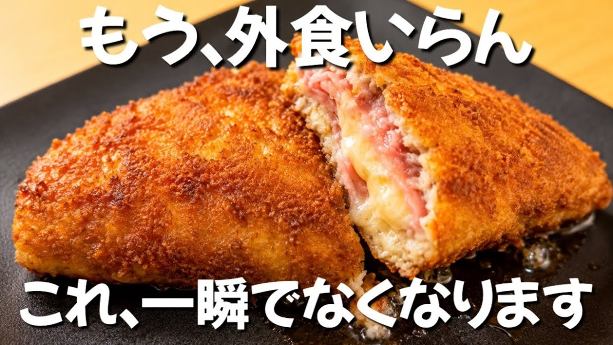

# 【300円の鶏ひき肉が化けた】カツ超えた。世界一簡単なカツレツ ずぼら主婦のずぼら飯

- 調べた日：2026-10-12（数字はいちばん新しい日の時点）
- チャンネル：ずぼら主婦ももこの節約ごはん（@ズボラももこ、登録者 36,800人）
- 公開日：2026-08-18　長さ：2分09秒　形：横長
- 再生：298,260回（登録者の 8.1倍）　高評価：1,437　コメント：104
- URL：https://www.youtube.com/watch?v=ip6XoPI0DVM

## サムネ

## 人気のコメント（いいねの多い順・上から10個）

1. （いいね 72）無礼を承知でごめんなさい…😅  今回は「ズボラ」 では無いのでは！？
2. （いいね 19）ひき肉だから生焼けも回避できるしこれは良いぞ しかもボリューム満点
3. （いいね 19）工程がズボラじゃなくて丁寧すぎる
4. （いいね 13）世界一の化けっぷり👻 ご飯にも合うし🍚 パンに挟んでもよさそう🥪
5. （いいね 9）もう出来上がりの見た目からして最強.....😍
6. （いいね 7）こんにちは！ 美味しそうです♪ ズボラではなく　手際抜群です♪
7. （いいね 7）ずぼらではないのにずぼらと言いきる潔さ、素敵です😊　子供達に食べさせたら「また作って‼️」と大好評でした。ありがとうございます‼️
8. （いいね 7）結構 手の込んだ料理。 手順はズボラかもしれないけど、総合的に見るとズボラじゃないw
9. （いいね 4）皆さんも言っている通り手際が良すぎです。マヨネーズでパン粉を接着は斬新です。時間をかけず知恵を活かす強力凄腕。今度買物で鶏ひき肉とハム購入❤
10. （いいね 4）料理は、簡単で　美味しいのが　1番😊

## メモ（なぜ伸びた？ 視聴者は何を求めている？）

- 
