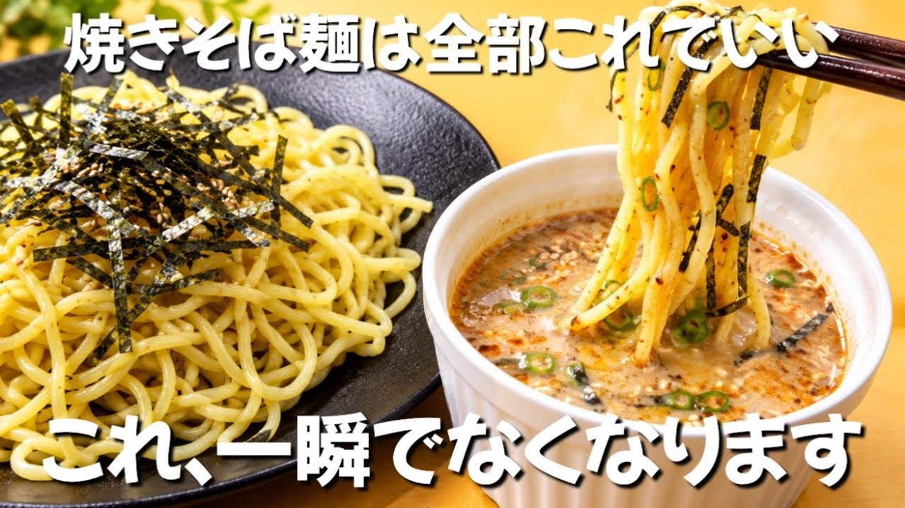

# 【1食60円】お金がない時はこれ 安い焼きそば1袋がごちそうに。3分で絶品ごまつゆ麺

- 調べた日：2026-10-12（数字はいちばん新しい日の時点）
- チャンネル：ずぼら主婦ももこの節約ごはん（@ズボラももこ、登録者 36,800人）
- 公開日：2026-09-22　長さ：1分25秒　形：横長
- 再生：1,916,803回（登録者の 52.1倍）　高評価：13,041　コメント：250
- URL：https://www.youtube.com/watch?v=FcrQdSL53XU

## サムネ

## 人気のコメント（いいねの多い順・上から10個）

1. （いいね 141）栄養(たんぱく質)足したい人は豚バラ、鶏ミンチ、シーフードミックス一緒にレンチン ボリューム上げつつカロリー抑えたい人はもやし、おくら、キノコ類を一緒にレンチン
2. （いいね 67）思わず「えっ？それだけ？」ってなっちゃいました ぜひ試してみます！
3. （いいね 46）めんつゆの表面が隠れるほどの炒りごまを入れるとゴマの食感で更にウマウマ。
4. （いいね 43）ももこ様  本当にまじ天才‼️ 絶対に思い付かない😅  ずぼら飯じゃなくて、これからは天才飯と呼ばせて頂きます。  本当全てのメニューが天才すぎる‼️
5. （いいね 37）つけ汁に揚げ玉入れたら旨いよ　ワイいつもそうしてる
6. （いいね 33）食後、少し足らなかったので家内に中華麺で、私はうどんで作ってみました。 家内も「これ本当に美味しい」と言って喜んでいました。 うどんもタレが凄く絡んで美味しかったです。 ありがとうございました。
7. （いいね 20）こういう本当にシンプルにできるお手軽料理ありがたい！！ 他の方とかでも簡単と言いながらそんな調味料ないよ！みたいな物を使ったり、料理しない人からするとかなり手間な事をやってたりして、動画見て後悔する事多いからこういう本当にシンプルに誰でも作れる本当な意味でお手軽料理動画ありがたい😌
8. （いいね 12）これは良いアイデアを知った。 ゴマダレが簡単に作れるようだ。 そうめん、ひやむぎでも出来るのでありがたい。
9. （いいね 12）麺料理の卵かけご飯ポジション来たかも。凄い。
10. （いいね 10）食べるラー油にしたり胡麻ドレを他のに変えたりでたくさん楽しめる有能メシ…

## メモ（なぜ伸びた？ 視聴者は何を求めている？）

- 
