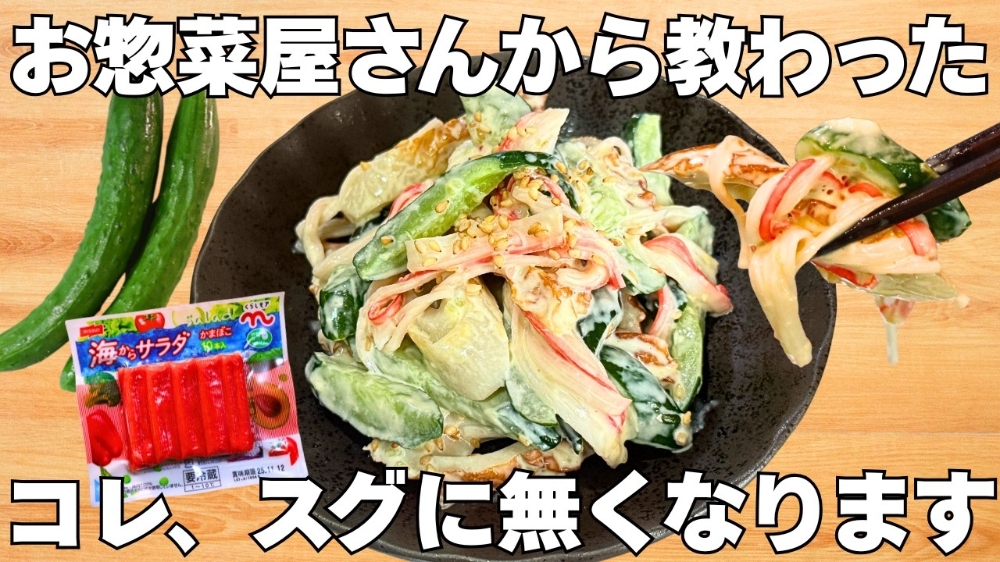

# 【もう水っぽくならない】切って混ぜるだけ！絶品カニカマきゅうり！秒でなくなる簡単副菜♪

- 調べた日：2026-10-12（数字はいちばん新しい日の時点）
- チャンネル：パパッとキッチン（@パパッとキッチン、登録者 10,000人）
- 公開日：2026-07-21　長さ：3分58秒　形：横長
- 再生：336,108回（登録者の 33.6倍）　高評価：2,328　コメント：21
- URL：https://www.youtube.com/watch?v=BuB-azlIPL4

## サムネ

## 人気のコメント（いいねの多い順・上から10個）

1. （いいね 26）🥒キュウリは野菜の中で①番好きなんです何故ってそれは楽で食べやすいから😆なんならそのままマヨ付けて食べれますからねw🥒
2. （いいね 14）カニカマ楽にほぐす方法ありますよ！手のひらにカニカマ乗せてもう片方の手のひらで擦ると簡単にほぐれます 説明下手でごめんなさい🙏
3. （いいね 10）簡単で美味しかったです。素材が全部お安いのがまたいい
4. （いいね 8）シメはコショウかと思ったらショウガでしたか。 目から鱗でした。
5. （いいね 7）お盆の料理一品完成〜😊
6. （いいね 7）簡単で美味しそうですね😊今冷蔵庫にきゅうりかにかまちくわ全部あるので今日の晩ご飯に作ってみます😊ゆで卵を入れても美味しそう😋
7. （いいね 4）作ってみました。美味しいです。 リピート確定😋 生姜を入れるのがいいなと思いました。
8. （いいね 3）子供が生姜の味に気付いて食べれなかったので次は生姜抜きで作ってみます😅
9. （いいね 1）初コメです。この動画がおすすめに上がりました。 生姜が無かったので抜きましたが、それ以外はそのまま作りました。 甘酢が効いているお陰で、マヨネーズのコッテリ感が薄れて食べやすかったです。 今度は、すりおろし生姜入れて作りたいと思います。

## メモ（なぜ伸びた？ 視聴者は何を求めている？）

- 
