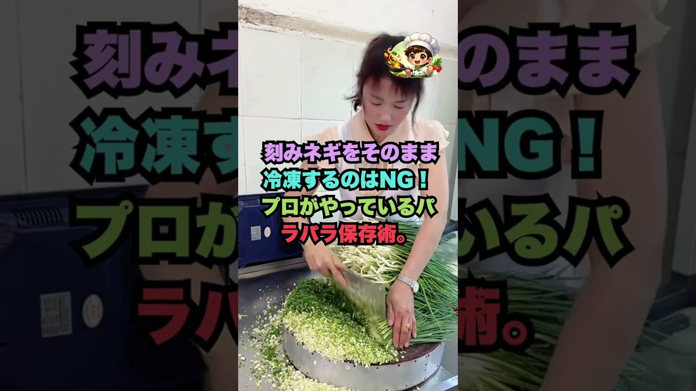

# 刻みネギをそのまま冷凍するのはNG！プロがやっているパラパラ保存術。#裏ワザ #裏技 #料理裏ワザ #生活の知恵 #ネギの保存

- 調べた日：2026-10-12（数字はいちばん新しい日の時点）
- チャンネル：ヘルシーレシピ（@ヘルシーレシピ、登録者 80,900人）
- 公開日：2026-09-25　長さ：1分06秒　形：ショート（縦長）
- 再生：4,591,028回（登録者の 56.7倍）　高評価：89,552　コメント：416
- URL：https://www.youtube.com/watch?v=5CDozI31qcE

## サムネ

## 人気のコメント（いいねの多い順・上から10個）

1. （いいね 1,641）はよ言えやって思うw
2. （いいね 805）２回タップは絶対したくないパターン
3. （いいね 669）この種の動画は画面を2回タップしてもらうのが目的だから絶体にタップしません。
4. （いいね 441）もしネギが固まっても、袋の上から叩くだけでオッケーよー。
5. （いいね 363）2回タップ詐欺は運営からBANして欲しい。
6. （いいね 348）ザル＋キッチンペーパーの上に広げ、10〜15分ほど置いて表面を少し乾燥させるとより効果的です。  2. ごま油やサラダ油を少量からめる 保存容器やフリーザーバッグに入れる前に、刻んだネギ全体にごま油やサラダ油（小さじ1/2程度）を薄く塗しておきます。油がコーティングとなって水分同士の結合を防ぐため、凍ってもパラパラにほぐれやすくなります。
7. （いいね 310）切ったネギにごま油（またはサラダ油）を数滴まぶして薄くコーティングさせてから冷凍する
8. （いいね 289）刻み葱は冷凍庫で30分凍らせてから一度　容器\袋をシャカシャカ振ってネギををパラパラにしたあと　再度冷凍しておけばくっつかないよ
9. （いいね 160）大丈夫👌こんなん慣れてるから2回トントンしないですぐにコメント欄に行く
10. （いいね 156）画面２回タップしても 答えた出ません

## メモ（なぜ伸びた？ 視聴者は何を求めている？）

- 
