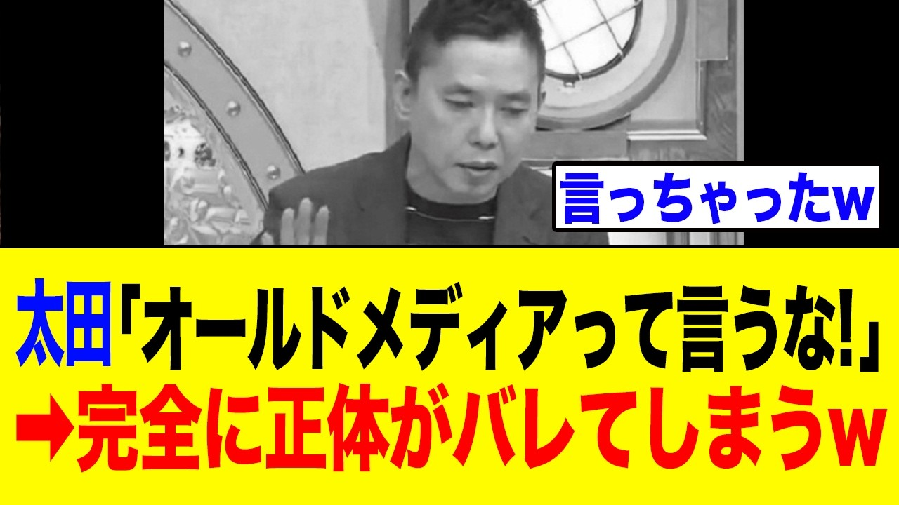

# 【衝撃】太田光さん、オールドメディア扱いにブチギレ→自らオールドメディアの代表になってしまうw w w

- 調べた日：2026-10-12（数字はいちばん新しい日の時点）
- チャンネル：政局の芯（@政局の芯、登録者 1,550人）
- 公開日：2026-10-03　長さ：9分03秒　形：横長
- 再生：73,027回（登録者の 47.1倍）　高評価：732　コメント：210
- URL：https://www.youtube.com/watch?v=mRHgq1NMNT4

## サムネ

## 人気のコメント（いいねの多い順・上から10個）

1. （いいね 133）新旧関係なしに信用できないのがマスメディア
2. （いいね 96）太田のようなクソ野郎にそんなこと言われる筋合いはねえよ
3. （いいね 89）TV衰退させた張本人たちの一人じゃん アホらしい
4. （いいね 83）世にオールドメディアというワードを浸透させた人にはノーベル賞クラスの報奨あげたいわ
5. （いいね 82）ん？ほな化石メディアと呼ぶな。
6. （いいね 81）意味わからん太田さん
7. （いいね 81）太田光氏も、まさかここまで 堕ちるとは思わなかったよ! 本当に、終わってるよオ―ルドメディア！！ 太田光は！！！！
8. （いいね 77）オールドメディアって言わず、 マスゴミって言え！
9. （いいね 56）最近はオールドメディアがネットに忍び込んで世論操作しようとしてるけど全然ダメやなw
10. （いいね 49）捏造までしてるのに停波しないのは相当甘いよね

## メモ（なぜ伸びた？ 視聴者は何を求めている？）

- 
