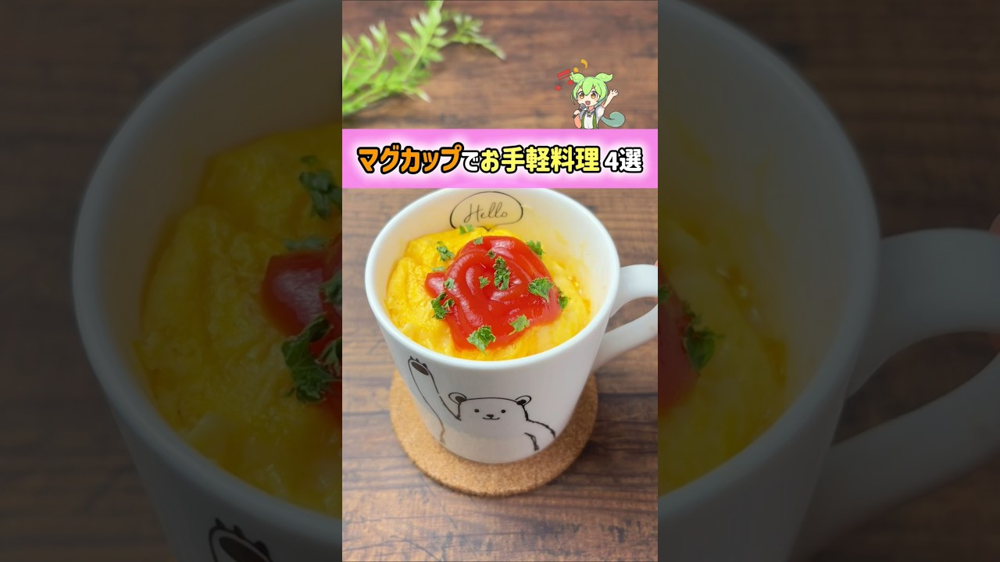

# 【超簡単】マグカップでできる絶品料理 4選

- 調べた日：2026-10-12（数字はいちばん新しい日の時点）
- チャンネル：歌唱ずんだもん（@歌唱ずんだもん、登録者 291,000人）
- 公開日：2026-08-06　長さ：1分01秒　形：ショート（縦長）
- 再生：5,741,372回（登録者の 19.7倍）　高評価：92,291　コメント：458
- URL：https://www.youtube.com/watch?v=jGC0dUpaQTw

## サムネ

## 人気のコメント（いいねの多い順・上から10個）

1. （いいね 1,599）ホケミってなんだ…って１分考えた ホットケーキミックスだった
2. （いいね 1,536）レンチン術師
3. （いいね 1,320）マグカップ一つでオムライスからフォンダンショコラまで作れるの錬金術すぎて草
4. （いいね 708）むかーしモコモコってマグカップでつくるカップケーキあったよな… こびりついて洗うの地獄だったの思い出したぜ
5. （いいね 619）2つ目、モッッッチモチになったのだ！ レシピは概要欄なのだ！
6. （いいね 220）こういうチーズって洗い物の時大変なんだよなー笑
7. （いいね 198）ホケミってなんだろと思って、概要欄見てもホケミって書いてあったからほんとにホケミって言う粉あるのかと思った笑
8. （いいね 184）オムライスはレンチン何分ですか
9. （いいね 132）ラスト以外マグカップじゃ足らんのよぉぉぉ!!!!
10. （いいね 49）この動画見るとレンジ作った人って凄いと思う

## メモ（なぜ伸びた？ 視聴者は何を求めている？）

- 
