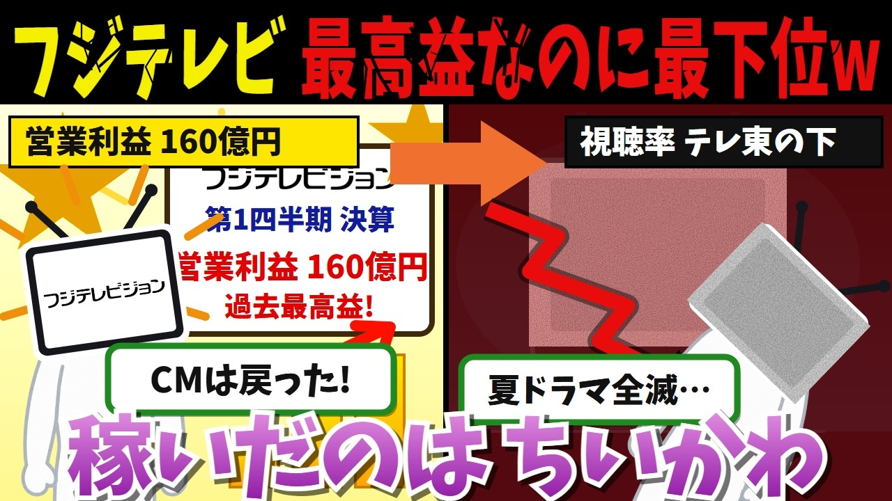

# フジテレビ「CMは全部戻った!過去最高益だ!」→結果、視聴率はテレ東に抜かれて夏ドラマ全滅、稼いだのは「ちいかわ」だった

- 調べた日：2026-10-12（数字はいちばん新しい日の時点）
- チャンネル：裏メディア研究所（@裏メディア研究所、登録者 746人）
- 公開日：2026-09-13　長さ：19分38秒　形：横長
- 再生：16,034回（登録者の 21.5倍）　高評価：124　コメント：51
- URL：https://www.youtube.com/watch?v=dvvkWISKgh0

## サムネ

## 人気のコメント（いいねの多い順・上から10個）

1. （いいね 44）週二回に５分だけ放送されるアニメに社運が掛かるフジテレビ
2. （いいね 38）ちいかわや鬼滅はどちらも自社コンテンツじゃないけどな。
3. （いいね 30）フジテレビを助けてくれるのは「不動産」と「F1」と「ちいかわ」ですか。心強いですね(笑)。
4. （いいね 26）フジテレビもいらないが、テレビ自体もいらない。
5. （いいね 25）「親も子も楽しめるアニメ」として映画ちいかわが大当たりした事だし、この際、1970年代までの母と子のフジテレビに戻して、昭和からのサザエさん、平成からのちびまる子ちゃん、令和のちいかわを軸に、ファミリー向けアニメ専門局として建て直すのはどうだろう？🤔 当然ながら世界名作劇場の復活は必須だが😉
6. （いいね 19）「韓国ドラマのリメイク」→解散で
7. （いいね 16）人と人を繋げる  社員と女と金を繋げる
8. （いいね 16）ちいかわを月9で放送したら、、 逆転満塁ホームランを打てるのでは？
9. （いいね 15）10％超えたのって…2025年の長時間記者会見以来ないような…
10. （いいね 10）誰が見てもだけどフジって編成がなってなさすぎる…と思う

## メモ（なぜ伸びた？ 視聴者は何を求めている？）

- 
