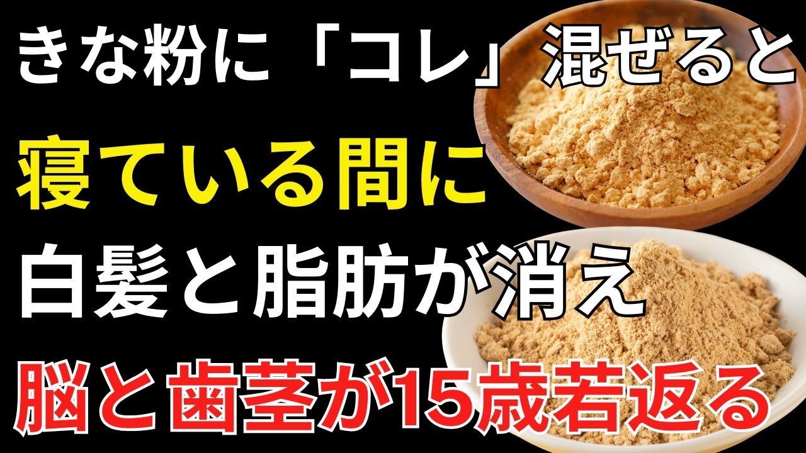

# きな粉に「コレ」を混ぜるだけ！粉のままは危険？栄養吸収を高める黄金のペースト練り｜シニア健康

- 調べた日：2026-10-12（数字はいちばん新しい日の時点）
- チャンネル：長生き健康の知恵（@長生き健康の知恵、登録者 5,610人）
- 公開日：2026-09-23　長さ：46分54秒　形：横長
- 再生：251,550回（登録者の 44.8倍）　高評価：2,621　コメント：93
- URL：https://www.youtube.com/watch?v=G3MTyJzrgQU

## サムネ

## 人気のコメント（いいねの多い順・上から10個）

1. （いいね 47）ヨーグルトに混ぜて3食食べて3年目くらいです。 きな粉も最近は中国産ばっかりです。なかなかないよ国産は😎
2. （いいね 45）解説ミスが不快 低下→ひくもと
3. （いいね 28）５円でなく誤嚥(ごえん)ですよ〰️。
4. （いいね 26）有り難く興味深いお話でしたが AIの為誤りが多数で、本当に聞きづらい。この長さはストレスたまります😅😢
5. （いいね 23）参考になりました〜 甲状腺の病気がありますので… 少しだけにします 毎日、豆乳飲んでますが先生は豆乳はいくら飲んでもいいと言ってましてが〜 きな粉はいれないで飲みます
6. （いいね 23）📌 ご視聴ありがとうございます😊 「きな粉に『コレ』を混ぜるだけ！粉のままは危険？栄養吸収を高める黄金のペースト練り｜シニア健康」では、きな粉の正しい食べ方と黄金ペーストの作り方を紹介しています🌿 ⏰ 0:00 効果が薄くなる理由⏰ 14:20 黄金ペースト練り⏰ 20:27 おすすめ組み合わせレシピ 役に立った方は👍高評価・共有・チャンネル登録で応援お願いします😊 きな粉の食べ方や健康の質問・感想もコメントで教えてください🌱
7. （いいね 17）さっそく　試してみます。髪が少なく白髪が増え悩んでいました。ありがとうございます。
8. （いいね 17）日本語の説明文の不出来から、内容の真実性が信じられないでしょう。論文なら、査読で、落ちるでしょう。
9. （いいね 15）カレ―❌️⤵️加齢⭕️👍 ヒクモト❌️⤵️低下 テイカ⭕️👍 ご縁❌️誤嚥誤嚥⭕️…日本語が可笑しい…内容信用出来ない😂  同じ様な動画が有りますよ⚠️
10. （いいね 13）きな粉は、冷凍ブルーベリーに振りかけ半分ほど解けたぐらいで、食しています。時に、黒胡麻粉だったり、高純度ココアパウダーにしてみたり、きな粉の甘みで十分な甘味を味わうことができます。 ほぼ毎日、50〜80g位を摂取し、幾分視力が改善した様な気分でいます。 因みに、71歳の高齢者です。

## メモ（なぜ伸びた？ 視聴者は何を求めている？）

- 
